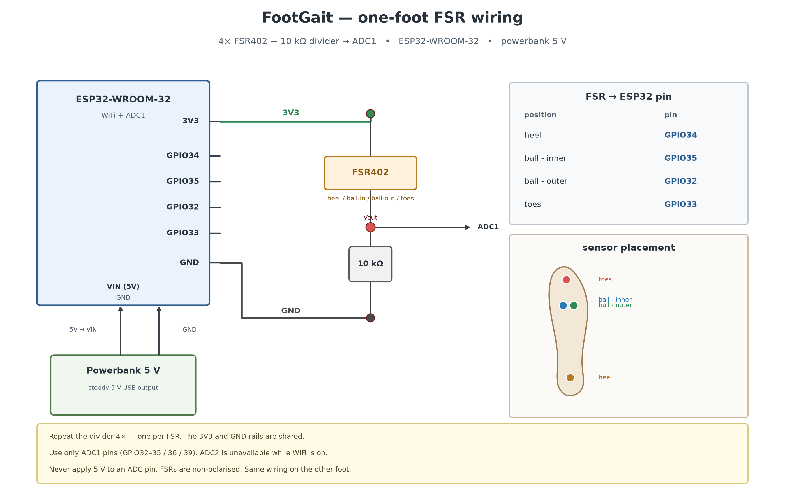

# FootGait — Wireless Foot-Pressure Telemetry & Gait Analysis

A real-time wireless foot-pressure monitoring system using two ESP32 boards with force-sensitive resistors (FSRs), designed for walking gait analysis and asymmetry detection.



## Features

- **Dual-foot wireless streaming** — two ESP32 boards (left/right foot), each with 4× FSR402 sensors, streaming at 50 Hz over WiFi/UDP
- **Live pressure heatmap** — Tkinter GUI with glowing insole visualisation, real-time force readings in N, %BW, or raw ADC
- **Gait asymmetry detection** — Robinson symmetry index, Plotnik swing asymmetry, bootstrap confidence intervals, composite severity scoring
- **Live asymmetry badge** — rolling-window online detector with colour-coded severity (symmetric → mild → moderate → severe)
- **Offline analysis** — stance/swing detection, cadence, centre of pressure, per-cycle feature extraction, publication-ready plots
- **Replay mode** — review any recorded session with full GUI playback
- **Sensor calibration** — zero-offset and multi-point force calibration workflow

## Hardware

| Component | Spec |
|-----------|------|
| Microcontroller | 2× ESP32-WROOM-32 (one per foot) |
| Sensors | 4× FSR402 per foot (heel, ball-inner, ball-outer, toes) |
| ADC | ESP32 ADC1 — GPIO34, GPIO35, GPIO32, GPIO33 |
| Divider | 3.3 V → FSR → 10 kΩ pulldown → GND |
| Power | 5 V powerbank → VIN |
| Protocol | UDP broadcast/unicast on port 4210, ACK on 4211 |

See [`hardware/wiring.md`](hardware/wiring.md) for the full schematic and pin map.

## Prerequisites

- **Python 3.10+** with `numpy`, `pandas`, `matplotlib`
- **Arduino CLI** or Arduino IDE with ESP32 board support
- A WiFi network the boards and laptop share

```bash
pip install numpy pandas matplotlib
```

## Quick Start

### 1. Flash the firmware

Copy `firmware/foot_node/secrets.example.h` to `secrets.h` and fill in your WiFi credentials:

```bash
# Left foot
arduino-cli compile --fqbn esp32:esp32:esp32 \
  --build-property 'compiler.cpp.extra_flags=-DDEVICE_ID=\"L\"' \
  firmware/foot_node

arduino-cli upload -p COM8 --fqbn esp32:esp32:esp32 firmware/foot_node

# Right foot (same sketch, different ID)
arduino-cli compile --fqbn esp32:esp32:esp32 \
  --build-property 'compiler.cpp.extra_flags=-DDEVICE_ID=\"R\"' \
  firmware/foot_node

arduino-cli upload -p COM9 --fqbn esp32:esp32:esp32 firmware/foot_node
```

### 2. Run the live GUI

```bash
python gui.py                        # live with force in N
python gui.py --units raw            # raw ADC values
python gui.py --units bw --body-kg 70  # percentage body weight
```

### 3. Analyse a recording

```bash
python analyze.py --file logs/gui_YYYYMMDD_HHMMSS.csv
```

Outputs land in `analysis/`: force plots, CoP trajectories, cycle breakdown, and the asymmetry report.

### 4. Replay a session

```bash
python gui.py --replay logs/gui_YYYYMMDD_HHMMSS.csv --replay-start 10
```

## Project Structure

```
├── firmware/
│   ├── foot_node/          # Main ESP32 sketch (build with -DDEVICE_ID)
│   │   ├── foot_node.ino
│   │   └── secrets.example.h
│   └── calibrate_serial/   # Raw ADC serial reader for calibration
├── hardware/
│   ├── wiring.md           # Full schematic and pin map
│   ├── wiring.png          # Wiring diagram
│   └── make_wiring_diagram.py
├── assets/
│   └── insole_outline.csv  # Insole outline for GUI rendering
├── gui.py                  # Live/replay GUI with pressure heatmap
├── logger.py               # Headless UDP logger (master CSV + snapshots)
├── processing.py           # Raw → mV → resistance → conductance → force
├── features.py             # Shared per-cycle gait feature extraction
├── asymmetry.py            # Symmetry index, bootstrap CI, classification
├── asymmetry_live.py       # Online rolling-window asymmetry detector
├── analyze.py              # Offline gait analysis with plots
├── simulate.py             # Synthetic gait generator for validation
├── calibrate.py            # Sensor zero/multi-point calibration tool
├── serial_calibrate.py     # Serial raw-value capture for calibration
└── sensor_config.py        # Sensor labels, positions, layout
```

## Asymmetry Detection

The system detects bilateral gait asymmetry through:

- **Per-cycle features**: stance time, swing time, stride time, step time, peak force, impulse, heel loading share, CoP path length, CoP medio-lateral range
- **Robinson SI**: `100 × (L − R) / (0.5 × (L + R))` per metric
- **Composite scoring**: weighted, threshold-normalised severity (0–100)
- **Classification**: symmetric · borderline · mild · moderate · severe
- **Detection rule**: ≥ 2 flagged metrics AND composite score ≥ 45

```bash
# Validate with synthetic data
python simulate.py --out logs/sim_symmetric.csv --symmetric --check
python simulate.py --out logs/sim_asym.csv --swing-asym 0.20 --peak-asym 0.20 --check

# Replay asymmetric gait with live badge
python gui.py --replay logs/sim_asym.csv --speed 4
```

## Calibration

```bash
# Zero sensors (foot unloaded)
python calibrate.py zero --from-log logs/session.csv --device all

# Add a known-weight calibration point
python calibrate.py add --device R --sensor 0 --raw 3100 --force 20

# View current calibration
python calibrate.py show
```

## Protocol

Each board sends UDP datagrams at 50 Hz:

```
seq,id,millis,fsr0,fsr1,fsr2,fsr3
42,R,15123,120,450,380,900
```

The laptop replies with `ACK:<id>:<seq>`. Boards start on broadcast, learn the laptop IP from the first ACK, then switch to unicast (with a 3 s broadcast fallback if ACKs stop).

## License

This project is for academic and research purposes.

The insole outline asset is derived from the [Brillnova-Insole](https://github.com/Brillnova/Brillnova-Insole) project (CC BY-NC).
